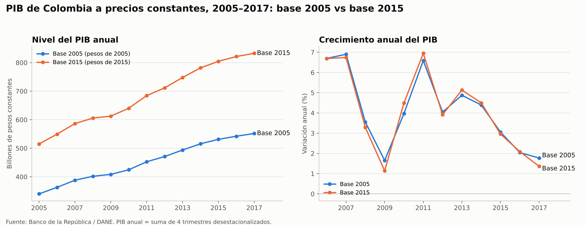

# PIB de Colombia: base 2005 vs base 2015

Comparación del PIB anual de Colombia a precios constantes bajo las dos metodologías del DANE (base 2005 y base 2015) en el periodo en que ambas existen, 2005–2017. Trabajo de **Macroeconomía I**, Universidad Nacional de Colombia, sede Medellín (2026-2).



## Qué encontramos

- **Los niveles no son comparables, pero la brecha es estable.** La serie en base 2015 es ~51 % mayor que la de base 2005 (razón entre 1,50 y 1,52 todos los años). Cada base valora la producción con los precios de su año de referencia, así que cambiar de base reescala la serie.
- **El crecimiento casi no cambia.** Entre 2006 y 2017 el PIB crece 4,13 % anual promedio con la base 2005 y 4,10 % con la base 2015. La diferencia absoluta promedia 0,24 puntos porcentuales por año.
- **Donde sí difieren: 2009–2011 y 2017.** La base 2015 estima un crecimiento menor en 2009 (1,14 % vs 1,65 %) y mayor en 2010 (4,49 % vs 3,97 %).
- La explicación completa está en el notebook y en el documento de `entrega/`.

## Estructura del proyecto

```
├── data/
│   ├── raw/          Series originales de Banrep, sin modificar (+ README de procedencia)
│   └── processed/    PIB anual 2005–2017 con crecimiento y razón entre bases
├── notebooks/        pib_bases_2005_2015.ipynb: el análisis completo
├── figures/          Gráficos generados por el notebook
├── entrega/          Documento editable (.docx) y PDF para entregar en Moodle
└── requirements.txt
```

Los datos originales nunca se editan. Todo lo de `data/processed/` y `figures/` se regenera corriendo el notebook.

## Cómo reproducirlo

```bash
pip install -r requirements.txt
jupyter nbconvert --to notebook --execute --inplace notebooks/pib_bases_2005_2015.ipynb
```

## Datos y limitaciones

- **Fuente:** Banco de la República, *Series estadísticas históricas de Colombia*, PIB por demanda, "1. PIB reportado" (cifras DANE). Consultado el 12 de octubre de 2026.
- Banrep ofrece estas series **trimestrales y desestacionalizadas**. El PIB anual se calcula sumando los cuatro trimestres, así que puede diferir levemente de la cifra anual oficial del DANE.

## Autores

David Fuentes Carrillo ([@dafuentes1209](https://github.com/dafuentes1209)) y Any Ruiz.
